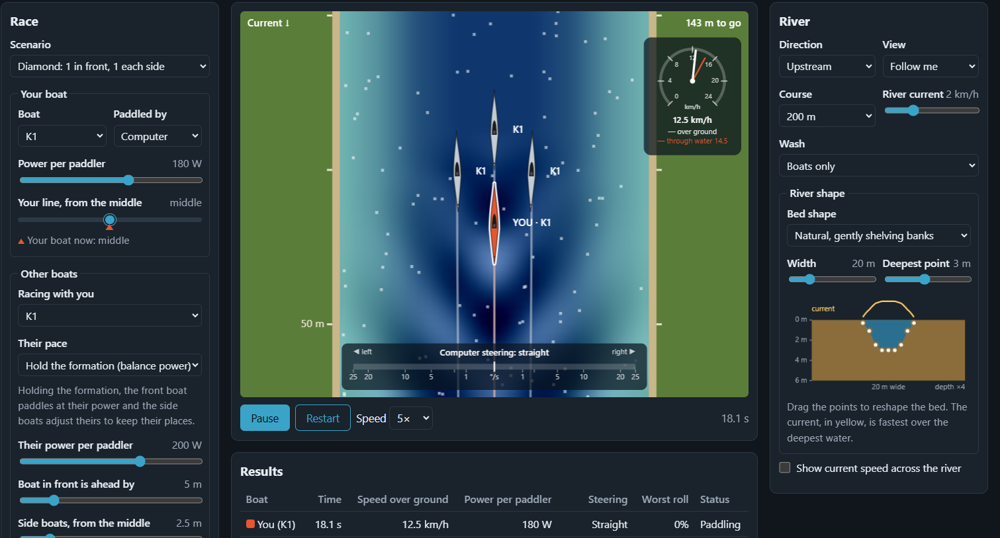

# Inside Line Sim
A river racing simulator for canoe and kayak marathon. Find the faster water before race day.

**Live site:** https://shan-sherif.github.io/inside-line-sim/

Race a K1, K2, C1 or C2 and see how current, shallow water and the wash of the boats around you change your time. After each run you see how your time compares with paddling the same line on your own.

## Setting up a run

The page opens on a demo: a K1 at 180 W, paddled by the computer in mid-river, racing a K2 at 160 W per paddler that sits 2 m to its right and 3 m ahead (**Side wash**). Boat wash is on, and the run goes upstream over 200 m against a 2 km/h current. The K1 settles about 2.3 m behind the K2, riding its side wash, and finishes about 1.4 s faster than it would on its own.

- **Direction:** upstream, downstream, or still water (regatta, no current). Your boat always travels up the screen, so the river flows down the screen going upstream and up it going downstream.
- **Course:** 100, 200, 500 or 1000 m.
- **River shape:** pick a bed shape (natural with gently shelving banks, canal with steep sides, deep middle channel, or shelving on one bank like the inside of a bend), then set the width (10–60 m, default 20 m) and the deepest point (0.5–6 m, default 3 m). To draw your own, drag the points on the cross-section. The cross-section is drawn to a fixed scale: its box is always 60 m wide and 6 m deep, with depth stretched 4×, so you can compare how wide and how steep different rivers are.
- **River current:** 0–7.2 km/h (default 2 km/h), the speed over the deepest water. The current follows the bed: fastest where it's deepest, slower over shallows and right against the banks. Shallow water also drags on the hull, so where you sit on the river matters. Tick **Show current speed across the river** to see the flow profile drawn on the water.
- **Scenario:**
  - **Solo:** on your own
  - **Stern wash:** 1 boat in front of you
  - **Side wash:** 1 boat beside you, on whichever side its line puts it
  - **Sandwich:** 1 boat on each side
  - **Diamond:** 1 boat in front and 1 on each side, with you at the back. **Their pace** sets whether every boat paddles at constant power, so the formation drifts as the wash helps some more than others, or whether the side boats balance their power to hold their places off the front boat (the default).
  - **Oncoming boat:** a K1, C1, speed boat or cruise boat passing the other way
  - **Overtaking boat:** a K1, C1, speed boat or cruise boat catching you up from behind and passing. Powered boats start with their bow 40 m behind you, paddlers 12 m behind, so a paddler only gets past if they're clearly faster than you.
- **Wash:** boats only, boats plus wash rebounding off the banks, or no wash at all. With rebound on, choose each bank's type (wall, piling, rock, natural earth, reeds and so on) or set how much it reflects, 0–100%. The reflected waves show on the water in magenta (crests) and deep purple (troughs), so you can tell them apart from the boats' own wash, and they act on the boats. See [Bank reflection](#bank-reflection) for the reference values. Wash and bank rebound sit in the River panel, above the river shape.
- **View:** **Fixed** shows the whole course with the boats moving across it; **Follow me** (the default) keeps your boat in place while the river scrolls past. Follow me shows about 25 m of river (more on a wide river, so the whole width fits) and is best for 500 and 1000 m.
- **Speed** (under the river): play the run at 1×, 2×, 5× (the default), 10× or 20× real time. Speed only changes how fast you watch the run. The physics still steps at 1/120 s, so results don't depend on it. At 20× a 1000 m course takes about 15–20 seconds to watch.
- **Your boat:** class, power per paddler (0–300 W) and your line, measured left or right of mid-river, in 0.5 m steps right up to either bank (0.5 m from it). You start in the middle.
- **Other boats:** their class and power, plus how far ahead of you they start, how far from the middle the side boats sit in Sandwich and Diamond, or the line of a single boat beside you or passing you. **Their line, from the middle** works like your line: slide left or right of mid-river to set which side the boat is on and how far out, so no scenario needs separate left and right versions. Other boats are placed from mid-river, not from you, so changing your line moves only your boat. Side distances and the passing line are capped to the room between mid-river and the bank, so no boat can be placed past a bank. Paddlers keep their centre 1.5 m from the bank, and powered boats keep their hull 0.5 m from it.
- **Passing boats:**

  | Boat | Size | Speed range | Starting speed | Wash at starting speed |
  | --- | --- | --- | --- | --- |
  | Speed boat | 5.5 × 2.2 m open runabout with an outboard | 5–45 km/h | 18 km/h | 0.29 m |
  | Cruise boat | 100 × 11.2 m passenger boat | 4–20 km/h | 12 km/h | 0.15 m |

  Picking a powered boat sets the speed slider to its range and starting speed. Speed is through the water, so the current adds to it or takes from it over the ground. Wash height follows speed (see [How wash changes with speed](#how-wash-changes-with-speed)), and **Passing boat wash size** scales it from 0.5× to 2× for a boat that throws more or less wash than typical. Under the sliders, the page shows the resulting wash height and the boat's speed regime, for example *Wash ≈ 0.29 m · near hull speed, half-planing: biggest wash*. A powered boat's wake starts at its bow, so a long cruise boat's wash reaches you before its stern does. On a narrow river a cruise boat can't clear the middle. At 11.2 m wide it fills more than half of a 20 m river, so its line only reaches 3.5 m either side of the middle and its hull always covers mid-river. Move your line to the other side to get past it.

*All speeds are shown in km/h.*

## Paddling it yourself

Set **Paddled by** to *Me*:

- **← / →** steer at full lock while held, or **drag the steering gauge** at the bottom of the river for a gentler turn. Let go to straighten up.
- **↑ / ↓** change your power in 10 W steps, from 0 to 400 W.
- On touch screens, on-screen buttons appear under the river, and touching the river steers instead of scrolling the page.

Otherwise the computer paddles your boat, holding your chosen line at your chosen power.

## What you see

- **River colour:** shows the depth, from pale green-blue over the shallows to deep navy over the deepest water, so you can see where the faster current runs. Wash shows as lighter and darker bands on top. Wash rebounding off a bank shows in magenta (crests) and deep purple (troughs). Its colour is exaggerated so it can be seen: a reflected wave 1 cm high already shows in full colour, so judge its strength from the results, not the colour. Reflections arrive well behind the boat that made the wash (about 28 m back for a K1 on a 20 m river), so in Follow me they appear near the bottom of the view. Fixed view shows the whole pattern.
- **Boats:** drawn from the top, with plan shapes traced from racing boats. Kayaks (K1, K2) have a needle bow, are widest just behind the cockpit, and have a rudder near the stern. Canoes (C1, C2) are a near-symmetrical spindle with one long open cockpit crossed by bulkheads. Hulls are drawn to scale in length and at 1.2× their real beam, so the slim shapes stay visible. The speed boat is an open runabout with a windscreen, two red seats and an outboard. The cruise boat is a Thames-style passenger boat with a blunt bow, a glazed forward saloon, rows of benches on the open upper deck and the wheelhouse aft. Both are drawn at their true size. When the view is zoomed out so far that any paddle boat's hull would be too small to make out (under about 25 pixels long or 3 pixels wide), every paddle boat shows as a triangle pointing the way it's heading, with a note that the view is drawn to scale. Paddle hulls and triangles are never mixed in one view. Powered boats go by their own size, so a cruise boat stays drawn to scale even when the paddlers are triangles.
- **Steering gauge:** the turn rate your boat is asking for, whether you or the computer is steering. Its scale is stretched near the centre so corrections of 1°/s or less are easy to see.
- **Line marker:** under the *Your line* slider, a marker in your boat's colour shows where your boat is now, so at the finish you can compare where you started with where you ended.
- **Speedometer:** speed over the ground (white needle) and speed through the water (coloured needle). The gap between them is what the current is doing to you.
- **Results:** time, speed, power per paddler, steering input and worst roll for every boat, and how your finish compares with paddling the same line alone.

## Boat settings

Edit each class's length, mass, drag, stroke efficiency, max turn rate, pivot point, steering cost, twist response, roll limit and wash height. Each setting is explained on the page. Changes restart the run and are saved in your browser; **Reset to defaults** puts them back.

Only the Boat settings are saved. Everything else on the page (scenario, river, wash, your boat, lines and so on) goes back to its default when you reload. The saved settings:

- are stored in this browser's local storage, on this device only. They aren't shared with anyone, and private windows don't keep them.
- hold only the values you've changed. Any setting you haven't touched keeps following the defaults in `js/boats.js`, so it picks up improvements when the defaults are updated. Setting a value back to its default stops saving it.
- are cleared completely by **Reset to defaults**.

## How the physics works

The physics is a simplified model for comparing boats and lines, not a hydrodynamic solver. Boat figures are illustrative, not measured hull data.

- **Paddling:** constant power per paddler against water drag that grows with speed², with extra drag in shallow water near the banks. Only part of the power drives the boat forward: 70% for a kayak's double blade, less for a canoe's single blade, which yaws the boat with every stroke. Steering costs power: a little with a kayak's rudder, a lot with a canoe's correction strokes.
- **Turning:** the hull turns about its pivot point. With a rudder the stern swings out and the pivot sits towards the bow. Current that's faster at one end of the hull than the other also twists the boat, and so does wash moving the bow sideways differently from the stern, so side wash and oncoming wash knock you off line and need correcting.
- **Wash:** every boat leaves a Kelvin wake, the V-shaped wave pattern all boats make, which grows with speed². The wake follows the path the boat actually took, drifts with the current, and keeps the size it was made with, so it bends round turns instead of swinging with the boat. With bank rebound on, wakes also reflect off both banks. The reflected waves are both drawn on the water and used in the calculations. The water drawing and the forces on each boat come from the same list of waves, so what you see is what pushes and rolls the boats.
- **Wash on other boats:** the slope of the water, averaged from bow to stern, pushes a boat down the wave face and rolls it. Averaging over the hull matters: a short paddle-boat wave has the bow and stern on opposite faces, so its push largely cancels, while a long powered-boat wave tilts the whole hull. Worst roll is shown as a % of each boat's capsize limit.
- **Wash riding:** sitting on a stronger pack's wash lets you hold their pace on less power, up to a point. In still water over 500 m, with K1s at a constant 210 W one 5 m in front and one each side (2 m from the middle, 3 m ahead), a K1 at 190 W stays with the pack. At 180 W it gradually drops off and finishes 3 s behind them, but the wash still makes it 2.7 s faster than paddling alone. To get past a pack you need to climb over their waves.

### Variables in the model

Most of these values are estimates, not measurements. If you have real figures, such as hull drag from a towing test, GPS speeds at a known power, the height of a K1's wash, or how far wash knocks your bow off line, please open an issue with the number and where it came from. Each row says where the value lives.

**Boat settings** (editable on the page, defaults in `js/boats.js`):

| Variable | K1 | K2 | C1 | C2 | What it controls |
| --- | --- | --- | --- | --- | --- |
| Length (m) | 5.2 | 6.5 | 5.2 | 6.5 | Twist from current and wash, how much the hull averages out short waves |
| Beam (m) | 0.41 | 0.41 | 0.35 | 0.45 | Drawing only (drawn at 1.2×). Not on the page, `js/boats.js` only |
| Mass with crew (kg) | 92 | 178 | 94 | 180 | How quickly the boat speeds up and slows down |
| Drag, `dragK` (N per (m/s)²) | 2.3 | 3.7 | 2.3 | 3.8 | The hull's resistance: top speed for a given power |
| Stroke efficiency | 70% | 70% | 56% | 58% | Share of the paddler's power that drives the boat forward |
| Sideways drag, `swayK` (N per (m/s)²) | 250 | 350 | 270 | 380 | How hard the hull resists sliding sideways. Not on the page, `js/boats.js` only |
| Max turn rate (°/s) | 25 | 20 | 18 | 16 | Turn rate at full steering |
| Pivot point (from bow) | 30% | 30% | 45% | 40% | The point the hull turns about |
| Steering cost (power at full lock) | 8% | 8% | 35% | 25% | Power lost to steering |
| Twist response (× the water) | 0.6 | 0.6 | 0.6 | 0.6 | How strongly the hull follows current or wash turning it |
| Roll limit (°) | 8 | 9 | 6.5 | 8 | Roll angle treated as a capsize |
| Wash height (m at 14.4 km/h) | 0.09 | 0.11 | 0.10 | 0.12 | Size of the wash the boat makes |

#### How the boat figures were chosen

The values are set so each class's speed and handling compared with the other classes matches what's seen in racing. No single hull was measured.

- **Drag (`dragK`) and stroke efficiency:** at steady speed, drag × speed = efficiency × power, so speed = ∛(efficiency × power × paddlers ÷ dragK). Drag is the hull alone; efficiency is how much of the paddler's power drives the boat forward. The K1's 2.3 and 70% give 13.5 km/h at 180 W, a club marathon pace, and about 5.2 m/s at 460 W, close to an elite 500 m. Published towing tests put K1 drag at about 50 N at 4.5 m/s, which also works out near 2.5. Race results put a double about 7–8% faster than the single of the same type, so the doubles use about 1.6 × the single's drag. At 180 W per paddler over 500 m in still water, the model gives K1 13.5 km/h, K2 14.5 km/h, C1 12.5 km/h and C2 13.5 km/h.
- **Canoes:** a C1 is 10–14% slower than a K1 in races, even though its hull is no wider (0.35 m against the K1's 0.41 m). The difference is the stroke, not the hull. A kayak's double blade alternates sides and drives straight. A canoe's single blade on one side pushes the bow away with every stroke, and the paddler corrects through the end of each stroke (a J-stroke or pitch), so less of the power drives the boat forward. Kneeling also changes how power reaches the boat. So the canoes keep hull drag similar to the kayaks (C1 2.3, the same as a K1; C2 3.8, a little above a K2 for its wider 0.45 m beam) and get a lower stroke efficiency: 56% for the C1 and 58% for the C2, against 70% for kayaks. The C2 is slightly more efficient because its two paddlers sit on opposite sides, so their pushes partly balance. With these figures the C1 comes out about 7% slower than the K1, a little gentler than the race range. Lowering its efficiency to 50% makes it about 11% slower, and 48% about 12%. Steering is counted separately, through steering cost.
- **Sideways drag (`swayK`):** ½ × water density × drag coefficient × the hull's side area below the water. A K1 has about 5.2 m × 0.12 m ≈ 0.6 m² of side area. With a coefficient of 0.7–1.1 for a rounded hull moving sideways, that gives roughly 200–350 for a K1 and 300–500 for the doubles. This controls how far wash shoves a hull sideways. For example, a speed boat overtaking 6 m away moves a computer-paddled K1 about 0.4 m off its line.
- **Roll limit:** the C1 is the least stable sprint boat (narrow, with the paddler kneeling high), so it has the lowest limit. The C2 is steadier than the C1 but less stable than the kayaks for its size.
- **Beam:** only sets how wide the hull is drawn. The model doesn't yet use it for drag or stability. A narrower hull should have less drag and a lower roll limit, so if you change beam, adjust those as well. See the To do list.

**River** (`js/physics.js`):

| Variable | Value | What it controls |
| --- | --- | --- |
| River width | 10–60 m on the page, default 20 m | Space for lines, how deep the middle gets, and how far bank rebound travels |
| Bed shape | Preset or drawn on the page: depth at 9 evenly spaced points across, joined by straight lines, never shallower than 0.2 m | Where the deep, fast water and the shallows are |
| Deepest point | 0.5–6 m on the page, default 3 m | Shallow-water drag, and the depth the current is measured against |
| Shallow-water drag | 1 + 1.5 × e^(−(depth − 0.3 m)/0.4 m): 2.5× drag at 0.3 m deep, about 1.3× at 1 m, almost none past 2 m | How much shallow water costs |
| Current vs depth | current ∝ (depth ÷ deepest depth)^(2/3), Manning's rule of thumb | How much slower the water is over shallows |
| Bank friction | current × (1 − e^(−distance from bank ÷ 1 m)) | How the current slows right against a bank or wall |

**Paddling and steering** (`js/physics.js`, `js/scenarios.js`):

| Variable | Value | What it controls |
| --- | --- | --- |
| Stroke efficiency | Per boat (see Boat settings): kayaks 70%, C1 56%, C2 58% | Share of paddler power that drives the boat forward |
| Thrust cap | 250 N per paddler | Pulling force when starting from a standstill |
| Steering response | about 0.25 s | How quickly the boat reaches the turn rate it's steered to |
| Computer steering | 2°/s of turn per degree off heading; heads back to its line at atan(0.15 × metres off line) | How tightly computer boats hold their line |

**Wash** (`js/physics.js`):

| Variable | Value | What it controls |
| --- | --- | --- |
| Wake angle | 19.47° each side | Shape of the V |
| Cusp wave direction | 35.26° from the track | Wavelength and crest angle |
| Wake width | 3 m + 5% of distance behind | How spread out each arm is |
| Wave fade with distance | ÷ √(1 + distance/40 m), × e^(−distance/250 m) | How far wash carries |
| Wake kept | 250 m behind each boat, recorded every 2 m | How long wash lasts |
| Wash push | 0.3 × g per unit of slope | How hard waves push a hull: wash riding and climbing the wash |
| Wave water speed | 3.5 m/s × slope | How hard waves twist a hull |
| Hull samples | 5, bow to stern | Averaging of wash over the hull |
| Bank rebound | 0–100% for each bank, default 30% (steep natural earth) | Share of wash height each bank reflects. Set by bank type or slider; see [Bank reflection](#bank-reflection) |

**Roll** (`js/physics.js`):

| Variable | Value | What it controls |
| --- | --- | --- |
| Natural roll period | 1 s | How quickly a boat rocks |
| Roll damping | 25% of critical | How quickly rocking dies away |
| Roll gain | 1.6 × the water's sideways tilt | Extra roll because the paddler sits high above the hull |

### Calculations and assumptions

The simulation steps 120 times per simulated second. Each step, for every boat:

1. **Water velocity.** The current at distance *x* from the left bank is `current × (depth at x ÷ deepest depth)^(2/3) × (1 − e^(−distance to nearest bank ÷ 1 m))`, where *current* is the River current setting. It flows straight along the river.
2. **Speed through the water.** The boat's ground velocity minus the water velocity, split into forwards (surge) and sideways (sway).
3. **Steering.** The turn rate asked for is your input (± max turn rate) or the computer's: 2 × heading error, capped at max turn rate. The actual turn rate moves towards *asked for + current twist + wash twist* over about 0.25 s.
   - **Current twist:** `twist response × (water speed at bow − at stern, sideways) ÷ length`.
   - **Wash twist:** `twist response × WAVE_SPEED × (sideways slope at each hull sample × its distance from the middle) ÷ (sum of squared distances)`. This is a best-fit rotation from the five samples.
   - The hull rotates about its pivot point, not its middle.
4. **Forward force.** `thrust − dragK × shallow factor × speed²`, where `thrust = power × paddlers × stroke efficiency × (1 − steering cost × steering share) ÷ max(speed, 1 m/s)`, capped at 250 N per paddler. The power is constant, so thrust falls as speed rises.
5. **Sideways force.** `−swayK × sway² − 20 × sway`, which stops the hull sliding sideways.
6. **Wash force.** `−0.3 × mass × g × (wave slope averaged over 5 points bow to stern)`. Slopes come from wave heights 0.25 m either side of each point.
7. **Roll.** A spring and damper with a 1 s period, driven by 1.6 × the average sideways tilt of the water under the hull. Worst roll = the largest roll ÷ roll limit.
8. **Own wash.** A paddle boat's wake height is `wash height × (speed through water ÷ 4 m/s)²`. A powered boat's follows the wash curve below. A point is added to the boat's wake path every 2 m it moves through the water, and every point already on the path drifts with the current.

#### How wash changes with speed

How much wash a boat makes depends less on its raw speed than on its speed compared with its hull length, measured by the **length Froude number**: `Fr = speed ÷ √(g × waterline length)`.

| Fr | What the boat is doing | Wash |
| --- | --- | --- |
| below about 0.4 | displacement: pushing through the water | small, growing with speed² |
| about 0.4–0.85 | hull speed and half-planing: stern squatting, climbing its own bow wave | **biggest** |
| above about 0.85 | planing: riding on top of the water | drops to about half the peak |

Powered boats use `wash = wash at starting speed × curve(Fr) ÷ curve(Fr at starting speed) × wash size`, where `curve(Fr) = (Fr ÷ 0.6)²` up to Fr 0.6, then `0.45 + 0.55 × e^(−((Fr − 0.6) ÷ 0.35)²)`.

| Speed boat | 5 km/h | 8 | 12 | 15 | 18 | 22 | 26 | 30 | 45 |
| --- | --- | --- | --- | --- | --- | --- | --- | --- | --- |
| Fr | 0.19 | 0.30 | 0.45 | 0.57 | 0.68 | 0.83 | 0.98 | 1.13 | 1.70 |
| Wash (m) | 0.03 | 0.08 | 0.17 | 0.27 | **0.29** | 0.24 | 0.18 | 0.15 | 0.13 |

At 100 m long, the cruise boat never gets anywhere near hull speed (Fr 0.11 at 12 km/h), so its wash keeps growing with speed²: 0.07 m at 8 km/h, 0.15 m at 12 km/h, 0.27 m at 16 km/h and 0.42 m at 20 km/h. Paddle boats stay below their peak too (a K1 at 14.4 km/h is at Fr 0.56), which is why their simple speed² rule holds.

In a test with a K1 in mid-river in still water, a speed boat passing 5 m away rolled it to 5% of its limit at 8 km/h, 95% at 18 km/h and 23% at 40 km/h. The worst wash comes from a boat going moderately fast, not flat out.

**Wave height at a point on the water.** Find the nearest point on the wake path. *Behind* is the distance back along the path from the boat to that point, and *side* is the distance out from it. Then:
- `distance from arm = side × cos 19.47° − behind × sin 19.47°`
- `envelope = e^(−(distance from arm ÷ width)²)` outside the V, and `0.25 + 0.75 ×` that inside
- `amplitude = wake ÷ √(1 + behind/40) × e^(−behind/250) × (1 − e^(−behind/3))`
- `wavelength = 2π × (speed × cos 35.26°)² ÷ g`, using the speed the boat had when it made that part of the wake
- `height = amplitude × envelope × cos(2π × (behind × cos 35.26° + side × sin 35.26°) ÷ wavelength)`

Heights from every wake on the water are added together. Bank rebound adds each wake's mirror image across each bank, scaled by that bank's reflection setting. A boat doesn't feel its own direct wake, but does feel its own rebound.

**Assumptions:**

- A straight river with the same width and bed shape along its whole length. The current flows straight down the river, with no eddies, cross-flows or bends.
- The current across the river follows the depth using Manning's rule of thumb (speed ∝ depth^(2/3)), which assumes the bed is equally rough everywhere. Real rivers also vary with weed, rocks and the shape of the reach upstream, and in a bend the fastest water swings towards the outside even where depths match.
- Deep-water wave behaviour everywhere, even in the shallow water near the banks.
- Each bank reflects a fixed share of every wave's height, the same all along the course. The bank types use general rules of thumb (see [Bank reflection](#bank-reflection)), not measurements of any river. Real reflection also depends on wave length and the angle the wave arrives at. Only a single bounce off each bank is modelled.
- Wake shape follows the ideal Kelvin pattern, sized by one height number per boat. Real wakes depend on hull shape, trim and depth.
- Paddlers put out steady power with no stroke-by-stroke surging, and a perfectly steady wake.
- Wash pushes a hull in proportion to the water's slope, and the slope sampled along the hull's centreline stands for the whole hull.
- Roll is treated as a simple spring and damper. The paddler doesn't brace or lean, and a roll past the limit is flagged but doesn't end the run.
- Boats don't collide, and computer boats never pull out to overtake.
- No wind.

### Bank reflection

How much of a wave's height different banks send back, from coastal engineering rules of thumb. Short waves like boat wash tend to reflect a little less off sloping banks than long sea waves, so treat these as starting points. The **Bank type** presets use the value in the last column.

| Bank type | Typical reflection | Preset |
| --- | --- | --- |
| Vertical wall, quay or lock wall | 90–100% | 95% |
| Steel or timber sheet piling (typical canal edge) | 80–95% | 90% |
| Steep smooth concrete or stone slope | 50–80% | 60% |
| Rock armour, rip-rap or gabions | 30–50% | 40% |
| Steep natural earth bank | 20–40% | 30% |
| Gentle gravel or sand slope | 5–20% | 10% |
| Reeds, vegetation or soft mud | under 10% | 5% |

For a mixed bank, use the type that covers most of the stretch you care about, or the one nearest your racing line.

## Running locally

It's plain HTML and JavaScript, with no build step.

- VS Code: right-click `index.html` and choose *Open with Integrated Browser*.
- Or with Python: `python -m http.server`, then open http://localhost:8000. Opening `index.html` directly in a normal browser won't work, because browsers don't load JavaScript modules from `file://`.

If a change doesn't show up after reloading, press **Ctrl+F5** to bypass the browser's cache.

## Project layout

| File | What it does |
| --- | --- |
| `index.html` | Page layout and controls |
| `css/style.css` | Styling, light and dark |
| `js/boats.js` | Default boat specs (length, drag, steering, stability, wash) |
| `js/boatEditor.js` | The boat settings table, saved in the browser |
| `js/riverEditor.js` | The draggable river cross-section |
| `js/physics.js` | River shapes, depth and current, wakes and their paths, boat motion and roll |
| `js/scenarios.js` | Directions, scenario line-ups, wash modes, computer steering, finish rules and the solo benchmark |
| `js/render.js` | Draws the river, wash, boats, steering gauge and speedometer for both views |
| `js/main.js` | Controls, keyboard and drag steering, simulation loop and results table |

## To do
- Options
  - More boat classes: OC1 (outrigger canoe) and surfski, each with their own drag, stability, steering (OC1 has an ama for stability and a single-bladed paddle; a surfski has a rudder and a double-bladed paddle) and wake.
  - Boat width variants: each class currently has one hull. Consider different widths within a class, e.g. narrow racing K1s versus wider, more stable ones (trading drag and speed for a higher roll limit). For C1, compare the high-kneeling position with sit-and-switch, which differ in stability, steering (correction strokes versus switching sides) and how the paddler's weight sits in the boat. For C2, consider paddlers paddling on the same side, and identify the stroke efficiency.
  - Full-screen mode for the Fixed view: on long courses the whole course is squeezed into the river panel, so the boats shrink to triangles. A full-screen button would give the river the whole screen height, keeping hulls visible on longer courses, with the steering gauge, speedometer and results overlaid or tucked to the side.
- Physics
  - Stern shape and transom wash: every hull makes waves at its bow and at its stern, and the wake is their sum. A sharp, pointed stern (racing kayaks and canoes) lets the water close in smoothly, so its stern waves are small and the wake is clean and easy to ride. A flat, wide transom (speed boats, many cruisers) leaves the water breaking away at slow speeds, dragging a pocket of churning water behind it. That makes a big stern wave, foam and turbulence (plus prop wash), and at half-planing speeds the squatting transom digs a deep hole followed by a big crest. Once planing, the transom runs dry and the stern wave shrinks. The model starts each wake from a single point, so hull shape only shows up in the wash height. Idea: give powered boats a second, smaller wave source at the stern, with a larger share for a transom at slow and half-planing speeds, to produce the messier, crossing wave pattern a transom makes, and possibly a turbulent stripe down the middle of the wake.
  - Factor in wind
  - Paddle strokes: see if we can simulate the stroke itself (kayak double-bladed strokes alternating sides, canoe single-sided strokes with correction strokes) and how each stroke surges, yaws and rolls the boat, instead of the steady push used now. The boats' `type` (kayak or canoe) is kept for this.
  - Eddies: slack or back-flowing water behind bridges, jetties and moored boats, with sharp eddy lines that spin the bow as you cross them
  - Shallow-water wakes: consider changing the wake angle in shallow water, if needed. The 19.47° Kelvin angle only holds in deep water. As a boat's speed approaches √(g × depth) (about 5.4 m/s, or 19.5 km/h, in 3 m of water, and 3.1 m/s, or 11.3 km/h, in 1 m), the wake widens towards 90° and the waves get bigger. Above that speed it narrows again. This matters most for speed boats and cruise boats on shallow rivers and canals.
  - Half-planing hump and speed ranges: calibrate the wash curve against real measurements. The peak position (Fr 0.6), the height of the peak and the planing level (45% of the peak) are rules of thumb, and the wash heights at the starting speeds (speed boat 0.29 m at 18 km/h, cruise boat 0.15 m at 12 km/h) are estimates. Real hulls differ: a deep-V planing hull, a flat-bottomed tender, a wake-boat with ballast and a catamaran ferry each have their own curve. The speed ranges (speed boat 5–45 km/h, cruise boat 4–20 km/h) should also be checked against local speed limits and the boats actually seen on race rivers. Wash measured at a known distance and speed, for example from a video against a marked post, would be the best calibration.
  - Cruise boats on narrow rivers: a big hull blocks much of the channel, so the water level drops alongside it (drawdown), a strong return current runs past it, and a long slow surge follows. None of this is modelled yet, and on a narrow river it can matter more than the wash itself.
  - With all the above considered, see if the simulation is close to real life.
- Environment
  - A river with bends
  - Turns on a straight river, around turning buoys
  - Race lane scenarios: a regatta-style start with boats in marked lanes (for example 9 lanes about 9 m wide, as on sprint courses), lane buoys drawn on the water, and a choice of which lane you're in. This would show how the wash from boats in the neighbouring lanes, and its rebound off the banks, reaches you, and which lanes are favoured on a river with current or shallow edges.

## About this project

I wanted to experiment and understand how the varied conditions when paddling affects the boat, and to help illustrate and identify potential tactics to save strength or to improve performance. Being able to find a good line when paddling is extremely useful to be efficient and also perform better in longer distances.

The live site counts visits with [GoatCounter](https://www.goatcounter.com/), which doesn't use cookies or collect personal data. Running the page locally isn't counted.

Inside-line-sim was written with the help of Claude Opus 5.5, an AI model by Anthropic, and the result was checked manually.
